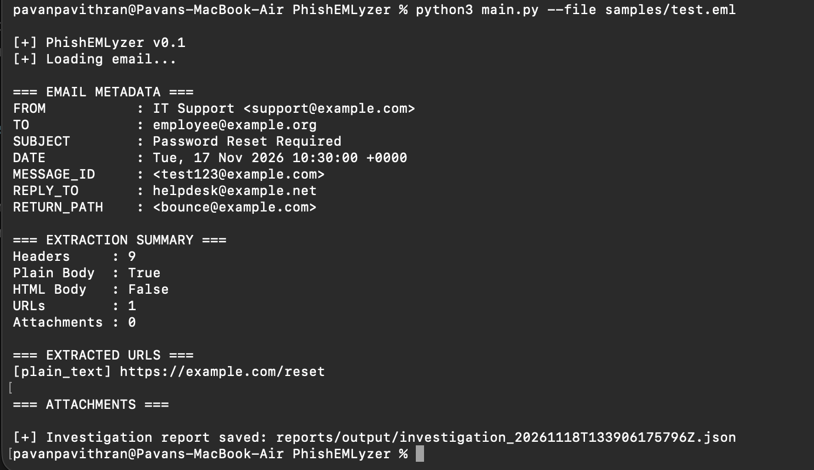
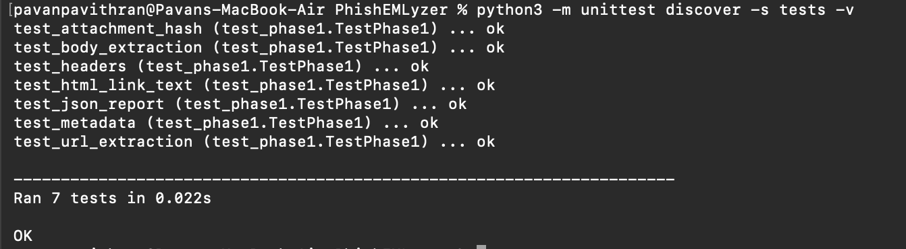
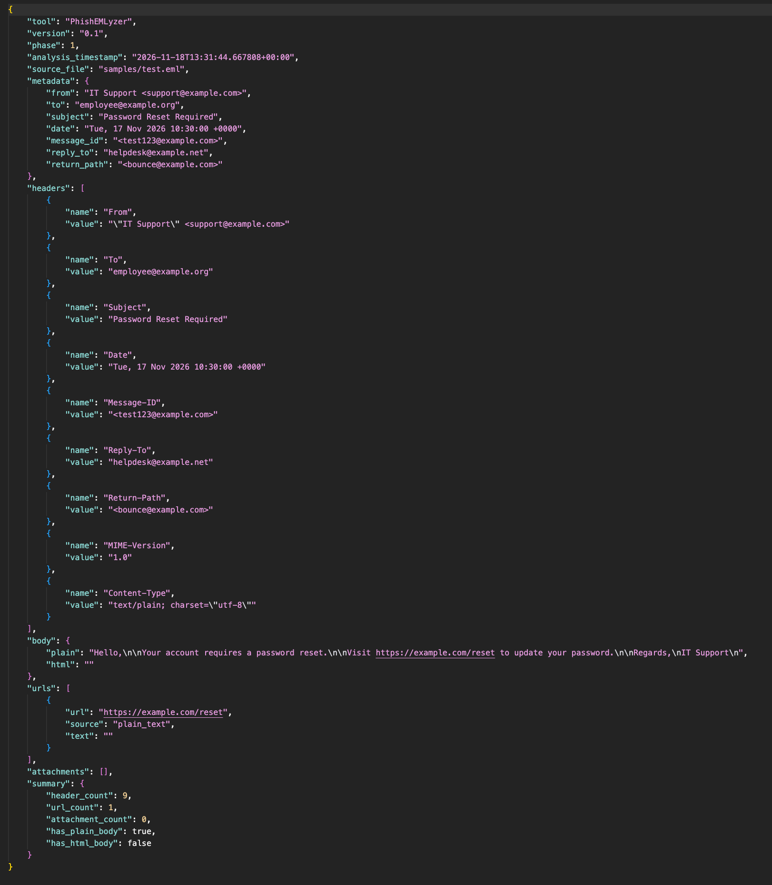

# 01 — Email Forensics and Parsing

**Project:** PhishEMLyzer — Phishing Email Forensics & SOC Investigation Platform  
**Phase:** 1 — Email Forensics & CLI Analyzer  
**Version:** v0.1  
**Language:** Python 3  
**Status:** Completed — Core functional tests passed

---

## 1. Objective and Scope

### 1.1 Objective

The objective of Phase 1 is to develop a modular, Python-based email forensics tool capable of extracting structured information from raw `.eml` files.

Phishing emails frequently contain indicators of compromise (IOCs), including suspicious URLs, misleading hyperlinks, malicious attachments, and inconsistent sender information.

Before these indicators can be evaluated, the underlying email content must be extracted and organized into a format suitable for further investigation.

Phase 1 establishes this foundation by implementing email parsing, MIME body extraction, URL extraction, attachment metadata collection, SHA-256 hashing, and JSON report generation.

### 1.2 Scope

The following capabilities were implemented:

- Load and parse `.eml` files.
- Extract email metadata and raw headers.
- Preserve duplicate header fields.
- Extract plain-text and HTML email bodies.
- Process multipart MIME messages.
- Extract HTTP and HTTPS URLs from email content.
- Preserve HTML hyperlink destinations and visible link text.
- Identify attachments and collect metadata.
- Calculate SHA-256 hashes of decoded attachment content.
- Generate structured JSON investigation reports.
- Provide a command-line interface for analysis.
- Execute automated unit tests.

The following capabilities are reserved for subsequent phases:

- Phishing detection and classification.
- SPF, DKIM, and DMARC authentication analysis.
- Domain impersonation detection.
- URL reputation lookups.
- Threat intelligence enrichment.
- Weighted risk scoring.
- SIEM integration.

**Phase 1 is a forensic extraction pipeline, not a phishing detection engine.**

---

## 2. Understanding `.eml` Structure and MIME

### 2.1 The `.eml` Format

An `.eml` file represents an individual email message using a format based on RFC 5322.

An email is composed of two primary sections:

1. **Headers:** Fields containing sender information, recipient information, timestamps, routing information, and other metadata.
2. **Body:** The content of the email, which may consist of plain text, HTML, multipart content, or attachments.

Example:

```text
From: "IT Support" <support@example.com>
To: employee@example.org
Subject: Password Reset Required
Date: Tue, 17 Nov 2026 10:30:00 +0000
Message-ID: <test123@example.com>
MIME-Version: 1.0
Content-Type: text/plain; charset="utf-8"

Hello,

Your account requires a password reset.

Visit https://example.com/reset.

Regards,
IT Support
```

The blank line between the headers and the message body separates the two sections.

### 2.2 Multipurpose Internet Mail Extensions (MIME)

MIME extends the email format to support different content types, character encodings, and file attachments.

Common MIME types include:

| Content Type | Purpose |
|---|---|
| `text/plain` | Plain-text email body |
| `text/html` | HTML-formatted email body |
| `multipart/alternative` | Alternative representations of message content |
| `multipart/mixed` | Multiple components, commonly including attachments |
| `application/pdf` | PDF attachment |
| `application/octet-stream` | Generic binary content |

A multipart email may have the following structure:

```text
multipart/mixed
│
├── multipart/alternative
│   ├── text/plain
│   └── text/html
│
└── application/octet-stream
    └── attachment.bin
```

PhishEMLyzer traverses these components to identify body content and attachments.

This is particularly important for phishing investigations because malicious indicators may be located in HTML hyperlinks or attached files rather than plain-text content.

---

## 3. Python Libraries and Parser Design

### 3.1 Libraries Used

Phase 1 was implemented using Python's standard library, without requiring additional third-party dependencies.

| Library | Purpose |
|---|---|
| `email.parser.BytesParser` | Parse raw email messages |
| `email.policy` | Configure email parsing behavior |
| `email.message` | Represent and process MIME messages |
| `pathlib` | File path handling and validation |
| `html.parser.HTMLParser` | Parse HTML and extract links |
| `re` | Extract URLs using regular expressions |
| `urllib.parse` | Parse URL structures |
| `hashlib` | Calculate SHA-256 hashes |
| `json` | Generate structured reports |
| `datetime` | Record investigation timestamps |
| `argparse` | Provide CLI argument handling |
| `unittest` | Implement automated tests |

### 3.2 Project Architecture

The application uses a modular design to separate the core forensic extraction tasks.

```text
PhishEMLyzer/
├── analyzer/
│   ├── __init__.py
│   ├── banner.py
│   ├── parser.py
│   ├── body.py
│   ├── urls.py
│   └── attachments.py
├── reports/
│   ├── __init__.py
│   ├── generator.py
│   └── output/
├── samples/
├── tests/
│   └── test_phase1.py
├── docs/
│   ├── 01-email-parsing.md
│   └── images/
├── main.py
├── README.md
├── requirements.txt
└── .gitignore
```

**Module responsibilities:**

- `main.py` — CLI entry point and orchestration.
- `parser.py` — Email loading, metadata extraction, and header extraction.
- `body.py` — Plain-text and HTML body extraction.
- `urls.py` — URL extraction from plain-text and HTML components.
- `attachments.py` — Attachment identification, metadata collection, and hashing.
- `generator.py` — JSON report generation.
- `banner.py` — Application banner.
- `test_phase1.py` — Unit tests for the extraction pipeline.

This architecture follows the principle of separation of concerns. Each module performs a specific task, allowing it to be tested and maintained independently.

### 3.3 Email Loading and Parsing

The initial entry point for parsing is the `load_email()` function in `analyzer/parser.py`.

```python
def load_email(file_path: str):
    path = Path(file_path)

    if not path.is_file():
        raise FileNotFoundError(
            f"Email file not found: {file_path}"
        )

    if path.suffix.lower() != ".eml":
        raise ValueError(
            "Only .eml files are supported."
        )

    with path.open("rb") as file:
        message = BytesParser(
            policy=policy.default
        ).parse(file)

    return message
```

**Technical decisions:**

**Binary input:** The email is read using `rb` mode to preserve its encoded representation for MIME-aware parsing.

**`BytesParser`:** Python's built-in parser handles email message structures, including encoded headers and multipart MIME content.

**`policy.default`:** Enables the modern `EmailMessage` interface, which simplifies content extraction.

**Input validation:** Basic checks reject nonexistent files and unsupported extensions.

The file extension check is not a security validation mechanism. A file with a `.eml` extension may still contain malformed or untrusted content.

---

## 4. Metadata and Header Extraction

### 4.1 Metadata Extraction

PhishEMLyzer extracts selected metadata fields from the parsed email.

| Field | Forensic Significance |
|---|---|
| `From` | Sender identity presented in the message |
| `To` | Intended recipient |
| `Subject` | Context of the communication |
| `Date` | Sender-declared timestamp |
| `Message-ID` | Message identifier for correlation |
| `Reply-To` | Requested reply destination |
| `Return-Path` | Envelope return address when available |

The extracted fields are returned as a Python dictionary.

These fields may provide useful evidence during a phishing investigation. For example, a difference between the sender domain and reply address may warrant further examination.

However, Phase 1 does not evaluate these inconsistencies.

### 4.2 Header Preservation

PhishEMLyzer extracts headers using the `raw_items()` method.

```python
def extract_headers(message):
    return [
        {"name": name, "value": str(value)}
        for name, value in message.raw_items()
    ]
```

Instead of using a dictionary indexed by header name, the application stores headers as a list.

This design preserves repeated headers such as:

```text
Received: from mail2.example.com
Received: from mail1.example.com
```

Preserving repeated headers is important for future email routing and authentication analysis.

It should be noted that extracted header values are stored as strings; the report is not a byte-for-byte forensic copy of the original message.

Additionally, email headers cannot be assumed trustworthy solely because they appear in the message.

---

## 5. Email Body Extraction

### 5.1 Objective

The objective of body extraction is to retrieve text-based message content from simple and multipart emails.

PhishEMLyzer supports two representations:

- `text/plain`
- `text/html`

Both representations are stored separately to preserve information relevant to later investigations.

### 5.2 Implementation

The `extract_body()` function uses `message.walk()` to traverse the MIME structure.

The extraction process:

1. Traverses the email's MIME components.
2. Skips multipart container objects.
3. Excludes parts identified as attachments or carrying filenames.
4. Identifies supported text content types.
5. Decodes the content into Python strings.
6. Stores plain-text and HTML content separately.

The resulting structure is:

```json
{
  "plain": "Hello, please visit https://example.com",
  "html": "<p>Hello, please visit <a href=\"https://example.com\">this link</a></p>"
}
```

### 5.3 Design Considerations

Preserving HTML is important because visible hyperlink text may differ from the underlying destination.

For example:

```html
<a href="https://example.net/login">
    https://example.com/login
</a>
```

The displayed link refers to one domain, while the actual destination refers to another.

This distinction is important for detecting deceptive hyperlinks in Phase 2.

The HTML content is parsed as data rather than rendered in a browser, avoiding the automatic execution of scripts or loading of remote resources.

### 5.4 Limitations

The current extractor is designed for common email MIME structures.

Unusual nested messages, malformed encodings, or complex MIME structures may require additional handling.

---

## 6. URL Extraction

### 6.1 Objective

The URL extraction module identifies HTTP and HTTPS links in plain-text and HTML email bodies.

Extracted URLs will later be used for phishing detection and threat intelligence enrichment.

### 6.2 Extraction Methods

PhishEMLyzer uses two approaches.

**Regular expressions**

A regular expression identifies HTTP(S) URLs appearing in plain-text content.

```python
URL_PATTERN = re.compile(
    r"https?://[^\s<>\"']+",
    re.IGNORECASE
)
```

**HTML parsing**

Python's `HTMLParser` identifies URLs contained in HTML attributes such as:

- `href`
- `src`

For hyperlinks, the parser also preserves the visible text.

### 6.3 Extracted URL Structure

Example:

```json
{
  "url": "https://example.net/login",
  "source": "html_href",
  "text": "https://example.com/login"
}
```

| Field | Description |
|---|---|
| `url` | Extracted destination URL |
| `source` | Location where the URL was identified |
| `text` | Visible text associated with an HTML hyperlink, if available |

URLs may originate from:

- `plain_text`
- `html_href`
- `html_src`
- `html_text`

The module also performs basic URL validation and removes duplicate entries with identical source and text values.

### 6.4 Security Considerations

The extraction module does not make network requests, follow redirects, or open discovered URLs.

This ensures that the initial analysis does not intentionally contact potentially malicious infrastructure.

The module does not determine whether a URL is safe.

### 6.5 Limitations

The initial URL extractor has several limitations:

- Regex-based URL extraction may mishandle unusual punctuation.
- Encoded or obfuscated links may not be recognized.
- Relative URLs are not included.
- URL normalization is limited.
- The HTML parser does not support every malformed HTML edge case.
- URL reputation is not evaluated.

These limitations will be addressed as part of later detection and enrichment functionality.

---

## 7. Attachment Identification and SHA-256 Hashing

### 7.1 Objective

The attachment module extracts file metadata and calculates cryptographic hashes without executing attachment content.

### 7.2 Attachment Identification

The module traverses the email MIME structure and identifies parts that:

- Have an attachment content disposition, or
- Contain a filename.

For each identified attachment-like component, it extracts:

| Field | Description |
|---|---|
| `filename` | Declared attachment filename |
| `content_type` | Declared MIME content type |
| `disposition` | Content disposition |
| `size_bytes` | Size of decoded attachment content |
| `sha256` | SHA-256 digest of decoded content |

### 7.3 SHA-256 Hashing

Python's `hashlib` library is used to calculate a SHA-256 digest.

```python
hashlib.sha256(payload).hexdigest()
```

SHA-256 generates a 256-bit digest, represented as 64 hexadecimal characters.

File hashes are useful for:

- Identifying duplicate file contents.
- Correlating attachments across investigations.
- Searching threat intelligence databases.
- Preserving file identifiers in incident reports.

A SHA-256 hash does not establish whether an attachment is malicious. It is a content identifier, not a malware verdict.

### 7.4 Security Considerations

The tool calculates hashes without deliberately executing attachments.

Decoded attachment bytes are processed in memory and are not written to standalone files during this step.

The current implementation does not inspect file contents for malware, identify actual file formats through magic bytes, or evaluate macros and embedded scripts.

Furthermore, the implementation does not yet enforce attachment size limits.

For this reason, the initial version should be tested using small, controlled samples.

---

## 8. JSON Investigation Report Generation

### 8.1 Objective

The reporting module consolidates extracted evidence into a structured JSON document.

JSON was selected because it is:

- Human-readable.
- Machine-readable.
- Easily parsed by Python and other tools.
- Suitable for integration with downstream detection systems and SIEM platforms.

### 8.2 Report Structure

Each report includes:

```json
{
  "tool": "PhishEMLyzer",
  "version": "0.1",
  "phase": 1,
  "analysis_timestamp": "<UTC timestamp>",
  "source_file": "samples/test.eml",
  "metadata": {},
  "headers": [],
  "body": {
    "plain": "",
    "html": ""
  },
  "urls": [],
  "attachments": [],
  "summary": {
    "header_count": 0,
    "url_count": 0,
    "attachment_count": 0,
    "has_plain_body": false,
    "has_html_body": false
  }
}
```

The above example illustrates the schema. Actual field values and counts depend on the analyzed message.

### 8.3 Report Storage

Investigation reports are stored in:

```text
reports/output/
```

The reporting module generates timestamp-based filenames:

```text
investigation_YYYYMMDDTHHMMSSffffffZ.json
```

Using UTC timestamps improves consistency across environments.

The application creates the report output directory when necessary.

### 8.4 Future Integration

The JSON report provides a common data structure that later modules can consume.

During Phase 2, the tool will use extracted indicators to generate detection findings and risk scores.

During Phase 5, investigation events can be adapted for ingestion into Wazuh.

### 8.5 Data Handling Considerations

Generated reports may contain sensitive information, including email addresses, message bodies, and embedded URLs.

Report files should be excluded from public Git repositories and handled according to the sensitivity of the original messages.

---

## 9. Command-Line Interface

### 9.1 Usage

PhishEMLyzer is executed through `main.py`.

```bash
python3 main.py --file samples/test.eml
```

The shorter `-f` argument is also supported:

```bash
python3 main.py -f samples/test.eml
```

The ASCII banner can be disabled:

```bash
python3 main.py -f samples/test.eml --no-banner
```

### 9.2 Execution Workflow

The CLI performs the following operations:

1. Validates and loads the email file.
2. Extracts selected metadata.
3. Extracts the complete header list.
4. Extracts plain-text and HTML bodies.
5. Extracts HTTP(S) URLs.
6. Identifies and hashes attachments.
7. Generates a JSON investigation report.
8. Prints an extraction summary.

### 9.3 Evidence — Successful CLI Execution

The screenshot below should demonstrate a successful analysis of a controlled sample email.



**Figure 1:** PhishEMLyzer CLI displaying extracted email metadata, URL information, attachment information, and the generated investigation report path.

---

## 10. Testing and Validation

### 10.1 Testing Approach

The extraction pipeline was validated using Python's built-in `unittest` framework.

The automated tests construct controlled email messages using `EmailMessage` and serialize them into MIME-formatted messages for parsing.

This allows repeatable testing without depending on real-world malicious emails.

### 10.2 Test Execution

Tests are executed using:

```bash
python3 -m unittest discover -s tests -v
```

### 10.3 Test Results

All seven implemented Phase 1 unit tests completed successfully.

| Test | Objective | Result |
|---|---|---|
| Metadata extraction | Verify selected headers are correctly extracted | PASS |
| Header extraction | Verify email headers are retrieved | PASS |
| Body extraction | Verify plain-text and HTML content extraction | PASS |
| URL extraction | Verify URLs are found in body content | PASS |
| HTML link text | Verify hyperlink text and destination are preserved | PASS |
| Attachment hashing | Verify attachment identification and SHA-256 calculation | PASS |
| JSON report generation | Verify creation of investigation report files | PASS |

**Result: 7/7 tests passed.**



**Figure 2:** Python unittest output showing successful execution of the seven Phase 1 functional tests.

### 10.4 JSON Report Validation

An investigation report can be inspected using Python's JSON formatting utility.

```bash
python3 -m json.tool reports/output/<report-filename>.json
```

The report contains the email evidence collected by the extraction pipeline, organized into structured JSON fields.



**Figure 3:** Example investigation report showing email metadata, extracted URLs, attachment hashes, and summary information.

### 10.5 Test Coverage Limitations

The successful tests validate the implemented core functionality under controlled conditions.

They do not establish complete support for all possible `.eml` files.

Additional tests are recommended for:

- Missing or duplicate email headers.
- Empty email bodies.
- Malformed MIME structures.
- Unusual content encodings.
- Inline attachments.
- Obfuscated and encoded URLs.
- Extremely large messages or attachments.
- Error handling during file operations.

---

## 11. Limitations and Security Considerations

Although the Phase 1 extraction pipeline is functional, several limitations remain.

### 11.1 No Phishing Classification

The application does not currently determine whether an email is malicious.

Extracted information is preserved for subsequent investigation.

### 11.2 No Authentication Verification

Headers such as `Authentication-Results` can be collected, but SPF, DKIM, and DMARC are not independently verified.

Any authentication claims must be assessed in the context of trusted receiving infrastructure.

### 11.3 No Threat Intelligence

The application does not query external reputation databases or classify extracted indicators.

### 11.4 No Attachment Content Analysis

Attachments are identified and hashed but are not scanned for malware or executed in a sandbox.

### 11.5 Limited Input Hardening

The application does not yet implement comprehensive resource limits or robust handling for every malformed email structure.

Large or deliberately crafted files may cause excessive memory consumption or parsing failures.

### 11.6 Sensitive Data Exposure

Email messages may contain personally identifiable information, internal correspondence, authentication tokens, or confidential links.

Generated reports contain extracted email evidence and must be handled appropriately.

### 11.7 Forensic Integrity

The tool does not modify the source email during normal extraction.

However, the current JSON report does not include a cryptographic hash of the original `.eml` file itself.

Recording the original message's SHA-256 digest would improve evidence identification and integrity verification in future versions.

---

## 12. Phase 1 Conclusion

Phase 1 of PhishEMLyzer established a modular command-line email forensics pipeline.

The implementation supports:

- Parsing `.eml` files.
- Extracting metadata and headers.
- Processing plain-text and HTML MIME content.
- Extracting URLs and preserving HTML hyperlink information.
- Identifying and hashing attachments.
- Producing structured JSON reports.

The implemented functionality was validated using seven automated unit tests, all of which passed.

The resulting architecture separates evidence extraction from interpretation, allowing future detection capabilities to operate on structured data.

**Phase 1 is considered complete against its defined functional scope, with additional robustness and security hardening identified for future development.**

The next phase will introduce rule-based phishing detection, email authentication analysis, suspicious URL identification, and explainable risk scoring.

---

## 13. References

1. [RFC 5322 — Internet Message Format](https://www.rfc-editor.org/rfc/rfc5322)
2. [RFC 2045 — Multipurpose Internet Mail Extensions](https://www.rfc-editor.org/rfc/rfc2045)
3. [Python — email.parser Documentation](https://docs.python.org/3/library/email.parser.html)
4. [Python — email.message Documentation](https://docs.python.org/3/library/email.message.html)
5. [Python — html.parser Documentation](https://docs.python.org/3/library/html.parser.html)
6. [Python — hashlib Documentation](https://docs.python.org/3/library/hashlib.html)
7. [Python — unittest Documentation](https://docs.python.org/3/library/unittest.html)